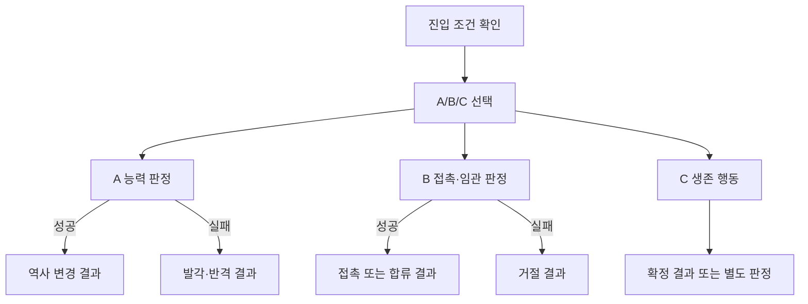

# 실행 흐름 설계 산출물

이 문서는 설계용 템플릿이다. 프로젝트 실행 스키마와 대조하기 전에는 실행 데이터로 사용하지 않는다.

## 1. 사건과 현재 상태

- 사건 ID / 제목 / 범위:
- 시기 / 날짜 정확도 / 장소:
- 분류: 정사 / 연의 / 게임 창작 (혼합이면 항목별 구분)
- 근거 자료와 미확인 사항:
- 플레이어 소속 / 역할 / 통솔·무력·지력·정치·매력:
- 관련 인물 생존·세력 상태 / 접촉·동행 증거:
- 선행 사건 / 확정 진입 조건 / 불충족 처리:
- 역사 기본 경과 / 이미 바뀐 전제:
- 판정 정책: 기존 엔진 확률 / 명시적으로 요청한 최소치

## 2. 장면

```text
[짧은 웹소설 제목]
📖 현재 상황 묘사: (현재 상태에서 실제로 성립하는 1인칭 3~4문장)
⚔️ 당신의 선택은?
[A] [구체적 행동] 현대인의 속마음. (필요 능력: … / 조건: … / 판정: …)
[B] [구체적 행동] 현대인의 속마음. (필요 능력: … / 조건: … / 판정: …)
[C] [구체적 행동] 현대인의 속마음. (필요 능력: … / 조건: … / 판정: …)
```

## 3. 분기표

| 선택 ID / 루트 | 행동과 의도 | 확정 조건·미달 처리 | 능력·비중·상대·판정 | 성공 결과 → 효과 → 다음 ID | 실패 결과 → 효과 → 다음 ID |
|---|---|---|---|---|---|
| `<scene>-a` / 원작 파괴 | | | | | |
| `<scene>-b` / 영웅 탑승 | | | | | |
| `<scene>-c` / 생존 | | | | | |

판정 없는 선택은 확정 결과와 다음 ID를 쓰고 실패 칸은 `해당 없음`으로 표시한다. 단순 논리 설득은 지력, 임관 요청은 매력, 전투는 통솔/무력, 일기토는 무력으로 설계한다. 최소치와 확률을 같은 의미로 쓰지 않는다.

## 4. 결과와 연결

각 분기에 아래 항목을 작성한다. 도표만으로 결과 문장을 대신하지 않는다.

```text
결과 ID:
직전 행동:
상대의 실제 반응:
결과 문장: (성패와 변화가 분명한 과거형 1~2문장)
효과: (정확한 대상 / 이전 값 → 이후 값 / 적용 시점)
다음 노드 또는 엔딩 ID:
다음 장면 첫 문장: (왜 이 상황으로 이어졌는지)
세계 영향: (후속 사건 개방·취소·변형 / 역사 지식의 유효 범위)
기록 분류: (개인 행동 / 배경 / 실제 결말 / 소식)
```

협상 성공은 신변 보장 성공과 다르다. 접촉 성공은 임관 성공과 다르다. 개인 임무 성공만으로 전역 승리를 확정하지 않는다. 서로 다른 결과가 합류하는 장면은 어느 경로에서도 성립하게 쓰거나 진입문을 분리한다.

## 5. 연결도

필요하면 Mermaid로 시각화한다. 노드 ID는 분기표와 일치시킨다.



각 말단을 실제 후속 노드/사건/엔딩에 연결하고, 확정 진입 조건의 불충족 경로도 실제 설계에 추가한다.

## 6. 경로 검수표

| 경로 | 확인할 내용 |
|---|---|
| A 성공/실패 | 역사 변화·반격의 원인과 후속 사건 변경이 일치하는가? |
| B 성공/실패 | 살아 있는 영웅에게 실제로 접근했는가? 거절 후에도 이어지는가? |
| C | 실행 가능한 생존 선택인가? 시간을 넘긴 뒤 세계 상태가 일치하는가? |
| 조건 미달 | 잠금·대체가 분명하고 미선택 상태가 보존되는가? |
| 합류 지점 | 앞선 성공/실패 모두와 문장이 양립하는가? |
| 완료·재진입 | 결과·효과·판정이 중복 적용되지 않는가? |
| 프로젝트 반영 | 관리자 목록·플로우·저장·게임에서 동일하게 동작하는가? |

보고에는 실제 확인한 항목만 표시한다. 설계만 한 경우 관리자·게임 검증은 `미실행`으로 남긴다.
