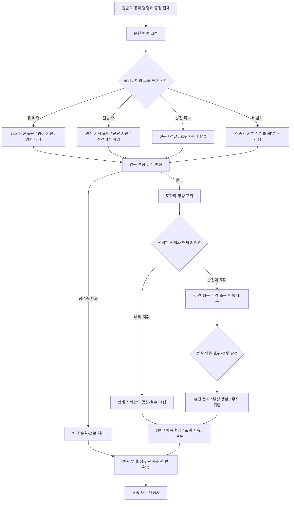
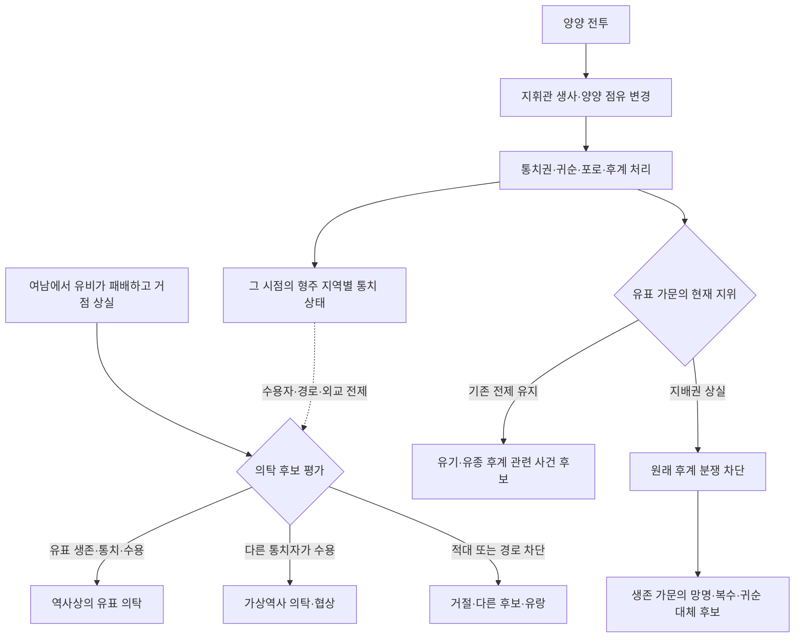

# 사건 전개·가상역사·사건 간 인과관계 설계

작성일: 2026-10-16. 현재 자료와 실행 코드를 확인한 후 작성한 제안이다. 이번 작업은 문서 작성이며, 아래 신규 모델·엔진·관리자 기능은 아직 구현하지 않았다.

## 1. 설계 결론

게임의 중심 단위를 **연도별 사건 목록에서, 조건에 따라 발생하고 세계를 바꾸는 사건**으로 옮긴다. 연월은 발생 가능 시기를 제한하고, 실제 발생·전개·결과는 현재 세계와 플레이어의 행동으로 결정한다.

하나의 사건을 `발단 → 전개 → 개입 → 판정 → 결과`로 수집한다. 결과는 인물 생사·세력 관계·지휘권·지역 점유 같은 공통 상태에 기록한다. 후속 사건은 앞 사건의 승자 문장을 읽는 대신 이 상태를 검사한다.

두 종류의 그래프가 필요하다.

| 구분 | 노드 | 연결의 의미 | 목적 |
|---|---|---|---|
| 사건 내부 플로 | 장면·조건·선택·판정·결과 | 다음 장면과 선택 경로 | 양양 전투에서 누구의 명령을 받고 무엇을 하는가 |
| 사건 간 인과 그래프 | 사건·발생 조건·세계 상태 | 필수 선행, 결과 전파, 대체·차단 | 양양의 지배자가 바뀌면 유비의 의탁과 형주 후계 분쟁이 어떻게 달라지는가 |

**모든 미래를 분기마다 별도로 작성하지 않는다.** 공통 사건에 현재 인물을 역할로 배정하고, 실제로 다른 전개만 별도 변형으로 작성한다. 다만 이름만 치환해서 성격·외교·지리까지 같은 사건처럼 실행하지는 않는다.

## 2. 현재 구현과의 차이

| 확인한 현재 상태 | 필요한 변경 |
|---|---|
| `chronology.json`은 짧은 사실 목록이며 `parentId`는 원문 목차의 상하 관계다 | 수집 항목을 사건군과 전개 단계로 묶고 시간 순서·인과관계를 별도 검토 |
| `HistoricalEvent`에는 한 개의 `source`와 선택적 `flow`가 있다 | 같은 사건의 정사 본문·주석·연의 전개를 별도 근거·변형으로 연결 |
| 내부 플로는 시작·조건·선택·결과·종료를 지원한다 | 역할 배정·판정·인물 및 부대 상태 효과·후속 예약 확장 |
| `getCurrentEvent()`는 같은 연도의 목록을 훑는다 | 연월은 후보 검색에 쓰고, 발생 조건·선행 결과·시간 범위를 평가하는 스케줄러로 전환 |
| `historicalGuard()`와 `defaultWorldEffect()`는 일부 사건 ID별 규칙이다 | 사건 데이터에 전제·기본 결과·대체 결과를 선언 |
| `World`는 플래그·세력 상태·지역 점유·적용 ID가 중심이다 | 인물의 현재 생사·소속·직책·관계, 부대·명령권과 사건 실행 상태 추가 |
| 플레이어 능력치는 체력·무력·지력·매력·자금이다 | 지휘 분기를 위해 `leadership` 통솔 추가. 장수 자료에는 이미 존재 |
| 장수의 시트 생몰년은 고정 참고값이다 | 현재 세계의 실제 생사와 분리. 손견 구출 뒤 시트 사망년으로 다시 죽이지 않음 |
| 개인·세계 로그는 최근 120개로 잘린다 | 조건 판정에 필요한 결과·상태는 영구 보관. 표시 로그를 인과 근거로 쓰지 않음 |

양양 전투 `timeline-7fec21d8cd02be2dad31`은 현재 193년·월 미상이며 지역·세력 배열이 비어 있고, 연결 장수는 유표 하나뿐이다. 손견·원술·황조의 역할과 전투 전개는 아직 수집되어 있지 않다. ID 연결만으로 플레이 가능한 사건이 완성된 것은 아니다.

## 3. 수집·규칙·실행 데이터를 구분한다

### 3.1 문헌 근거: 무엇이 기록되어 있는가

`sourceRecords`에 문헌 근거를 저장한다. 중국어 원문 덤프 대신 한국어로 요약한다.

| 필드 | 내용 |
|---|---|
| `id`, `work` | 근거 ID, 문헌명. 예: 정사 삼국지 손파로토역전 |
| `locator` | 권·전·회차·기사 위치. 예: 권46 손견조 초평 3년 기사 |
| `layer` | `historyMain` 정사 본문 / `historyAnnotation` 주석 인용 / `novel` 연의 |
| `quotedWork` | 주석이 인용한 문헌명. 예: 전략, 영웅기 |
| `record` | 해당 전개를 확인할 수 있는 한국어 기록 요약 |
| `dateClaims` | 문헌에 나타나는 연월·정확도·이견. 모르는 월은 `null` |
| `reviewStatus` | `unverified` / `reviewed`. 인물 ID 추정과 원사서 확인은 별도 |

플레이용 출처는 문헌명과 위치다. 수집 URL·접근일·라이선스 등 조사 이력은 메타데이터 또는 관리 문서에만 둔다. 사건 출처를 URL로 대체하지 않고 원문·HTML을 `raw` 폴더에 쌓지 않는다.

### 3.2 사건 정의: 무엇이 어떻게 진행되었는가

`eventDefinitions`는 의미 있는 사건 하나를 담는다. 같은 전투를 여러 연표 항목에서 가져와도 정의는 하나로 묶고 원래 ID를 `referenceEntryIds`에 보존한다.

| 필드 | 수집·작성 내용 |
|---|---|
| `id`, `referenceEntryIds` | 안정적인 사건 ID, 대응 연표·기존 게임 사건 ID |
| `title`, `kind` | 사건명, 전투·외교·등용·일화·후계 등 분류 |
| `historicalDate`, `activationWindow` | 문헌상 시기와 게임에서 허용할 발생 범위를 분리 |
| `places` | 도시·군·주·하천·산과 관계, 공격·방어·이동 경로 |
| `participants` | 장수·세력 ID와 발령자·지휘관·방어자·추격자 등 역할 |
| `causes`, `objectives` | 발단과 각 진영의 목표 |
| `stages` | 단계별 행동·행위자·장소·전후 조건·문헌 근거 |
| `variants` | 정사 본문·주석·연의 전개 중 구별해야 하는 차이 |
| `baselineOutcome` | 개입이 없고 역사적 전제가 유지될 때의 기본 결과 |
| `readSet`, `writeSet` | 읽고 바꾸는 세계 상태. 조건·효과에서 자동 추출 |
| `coverage` | 자료만 있음 / 전개 확인 / 분기 작성 / 연계 검증 / 게시 가능 |

각 단계에는 최소 `id`, `actorBindings`, `placeId`, `action`, `requires`, `sourceRecordIds`를 둔다. 발단·야전·도하·포위·추격·습격을 분리하되, 동일한 선택과 결과를 공유하는 문장마다 노드를 만들지는 않는다.

### 3.3 게임 규칙: 어디를 바꿀 수 있는가

역할별 진입 조건, 선택, 판정, 결과와 대체 사건을 작성한다. `eligibility`, `roleBindings`, `flow`, `outcomes`, `fallbackPolicy`를 둔다. 이런 선택·능력 판정·대체 결과는 `authored` 게임 창작으로 표시하며 문헌 근거와 섞지 않는다.

조건은 생사·소속·위치·직책·능력·관계를 허용된 연산자로 조회한다. 실행 문자열·임의 JavaScript를 데이터로 받지 않는다.

### 3.4 실행 중인 세계: 이번 플레이에서 무엇이 일어났는가

문헌과 정의는 읽기 전용이다. 실제 생사·점유·관계와 진행은 세이브에 저장한다.

| 상태 | 최소 필드와 원칙 |
|---|---|
| 인물 | `personId`, `lifeStatus`, `factionId`, `locationId`, `officeIds`, 부대·주요 관계 |
| 세력 | `factionId`, `leaderId`, 존속 상태, 후계·동맹·종속 관계 |
| 지역 | `placeId`, `controllerFactionId`, 점유·분쟁 상태. 주 전체와 한 도시 점유 구분 |
| 군대·작전 | `armyId`, 지휘관, 작전 소속, 주둔지, 병력·군량·사기 등 판정 입력 |
| 사건 실행 | `instanceId`, `definitionId`, 변형, 배정 인물, 현재 노드, 상태, 결과 ID, 적용 효과 ID |
| 인과 기록 | 변경 전 값·새 값, 원인 사건/결과, 실행 순서 |

생사 미확인은 사망으로 취급하지 않는다. 시트 생몰년은 초기 후보 판별·기본 역사 편성에 참고하되 가상역사 생존을 덮어쓰지 않는다. 자연사·노화는 별도 설계 대상이며 이번 범위에서 세대교체를 추가하지 않는다.

170~190년 중 시작한 시점의 인물·세력·점유를 초기 스냅샷으로 구성한다. 그 이전 기본 경과를 적용하고 이후에는 실행 결과만 누적한다. 이미 분기한 세계를 매년 역사 초기값으로 다시 만들지 않는다. 지도자 사망과 세력 멸망도 별개이며 후계자가 있는 세력은 지도자 승계 결과로 처리한다.

## 4. 데이터를 수집하고 연결하는 절차

1. 기존 연표 785개와 게임 목록에서 중복·세부 항목을 찾아 사건군을 만든다. 원래 ID는 유지한다.
2. 연표·삼국지14 이벤트 목록은 조사할 소재의 인덱스로 사용한다. 짧은 제목을 완성된 전개로 간주하지 않는다.
3. 관련 인물의 정사 열전·주석과 해당 연의 회차를 각각 확인한다. 다른 인물의 열전에만 있는 경과도 합친다.
4. 발단·참여자·장소·전개·결말을 한국어로 추출하고 단계별 근거를 붙인다.
5. 인물·세력·지역을 ID로 연결한다. 기존 사용자 지정과 추정 근거를 보존한다. 시트에 없는 인물은 별도 역사 인물 ID와 `officerId: null`을 사용한다. 비슷한 이름의 장수에게 붙이지 않는다.
6. 연대·행위자·사망 방식의 차이는 변형으로 구분한다. 하나의 확정 문장으로 섞지 않는다.
7. 단계별 플레이어 개입 지점·명령권 조건과 결과가 바꾸는 상태를 작성한다.
8. 바뀌는 상태를 읽는 후속 사건을 찾아 재검증한다. 직접 연결뿐 아니라 여러 단계 뒤의 영향도 검사한다.
9. 기본 경로·진영별 개입·인물 사망·지역 점유 변경을 검증한 사건군만 게시한다.

기계 추출이나 Gemini CLI는 1차 구조화와 후보 찾기에 사용할 수 있다. 출처에 없는 장면·월·동기를 채우거나 전체를 자동 검증 완료로 표시하지 않는다. 분기는 실행 전 구조 검사와 사람의 문헌 대조가 필요하다.

### 사건별 수집 카드

```yaml
사건ID: 안정적인 ID
대응연표ID: []
연월: {연도: null, 월: null, 정밀도: 미확인, 이견: []}
지역: [ID, 지역 단계, 상위 지역]
세력: [ID, 소속과 동맹·종속 관계]
인물: [인물ID, 장수ID, 역할, 확인 또는 추정 근거]
발단과목표: 한국어 요약
전개:
  - 단계ID: 단계명
    행위자: 역할 또는 인물ID
    행동과장소: 한국어 요약
    선행조건: 확인 가능한 전제
    출처: 문헌 근거ID
    사서기록: 한국어 기록 요약
전개변형: [정사 본문, 주석 인용문헌, 연의 회차별 차이]
개입지점: [진영, 역할, 선택, 판정 입력]
결과: [생사, 포로, 소속, 지휘권, 점유, 외교관계]
영향받는사건: [사건ID, 바뀌는 전제, 대체 또는 차단 방식]
검증상태: 자료만 있음
```

## 5. 양양 전투의 정사·연의 전개 수집 예시

정사 본문은 원술의 명령, 황조 격파, 한수 도하, 양양 포위와 손견의 전사를 기록한다. 주석의 《전략》은 야간 추격·숲에서의 사격을, 《영웅기》는 여공과 낙석 및 다른 사망 날짜를 전한다. 연의 제7회는 괴량의 계책·여공의 유인과 매복을 상세히 전개한다. 근거는 [삼국지 권46 손견조](https://zh.wikisource.org/zh-hant/三國志/卷46), [삼국지연의 제7회](https://zh.wikisource.org/zh-hant/三國演義/第007回)에서 확인했다.

현재 연표는 193년, 정사 본문은 초평 3년인 192년, 주석의 《영웅기》에는 초평 4년 날짜가 있다. 원문 연대와 게임 대표 연도를 별도로 기록하고 대표 연도는 편집 검토 후 선택한다. 이 문서 작성만으로 기존 데이터를 수정하지 않는다. 37세 기록과 시트 생년으로 문헌 간 차이를 자동 해소하지 않는다.

같은 사건에 `history-main`, `annotation-dianlue`, `annotation-yingxiongji`, `novel-ch07` 같은 변형을 둔다. 실제 ID는 편집 시 확정한다. 실행할 때 하나를 선택하고 인스턴스에 고정해 서로 충돌하는 사망 장면이 연속 실행되지 않게 한다.

연의 전개를 역사 연대에 배치할 때는 대응 시기라는 설명을 붙인다. 전역 정사/연의 모드 UI부터 추가하지 않고, 먼저 관리자가 사건별 허용 변형과 기본 변형을 지정하도록 한다.

사건 카드의 단계 초안은 다음처럼 만든다. 이 표의 개입·결과는 게임 설계이며 문헌에 기록된 플레이어 행동이 아니다.

| 단계 | 근거가 있는 기본 경과 | 작성할 개입·대체 결과 |
|---|---|---|
| 발령 | 원술이 손견에게 유표 공격 명령 | 대리 지휘 위임·준비·명령 거부의 가능 조건 |
| 야전 | 황조를 격파 | 방어측 승리·지연·공격측 퇴각 |
| 도하·포위 | 한수 도하 후 양양 포위 | 도하 저지·보급 차단·포위 실패 |
| 야간 행동 | 《전략》의 황조 출병·패주와 손견 추격 | 정찰·추격 중지·호위·유인 대응 |
| 매복 | 문헌 변형별 사격 또는 낙석 | 전사·부상·구출. 지휘관이 교체되면 대상도 재평가 |
| 전후 처리 | 선택한 문헌 변형의 확인된 후속 경과를 추가 조사 | 포로·항복·점유·지휘권·후계 결과 작성 |

연의의 매복은 연의 변형에서 별도 장면으로 편집한다. 위 단계를 기계적으로 모두 공통 적용하지 않는다. 자료에 없는 전후 처리는 미확인으로 두고 게임 창작 규칙과 구별한다.

## 6. 역할과 지역을 정확하게 표현한다

### 6.1 소속과 작전 지휘 계통

손견의 군대가 원술의 명령으로 출정하더라도 발령자·상위 세력·현장 지휘관은 다르다. 현재 `factionId` 하나로 모두 표현하지 않는다.

| 역할 | 기존 장수 문서 ID |
|---|---|
| 발령자 원술 | `rtk14-0032` |
| 공격 지휘관 손견 | `rtk14-0551` |
| 방어 세력 지도자 유표 | `rtk14-0953` |
| 방어 지휘관 황조 | `rtk14-0260` |
| 이후 의탁 주체 유비 | `rtk14-0952` |
| 유표의 아들 유기 | `rtk14-0929` |

`issuer`, `attackingCommander`, `defendingCommander`, `hostRuler` 같은 역할을 인물·세력·부대에 연결한다. `attackingCommander = player`가 되어도 점령지를 플레이어 개인에게 자동 귀속시키지 않는다. 원술의 위임 조건·병력 소유·독립 여부에 따라 점유와 통치권을 판정한다.

### 6.2 진영·위치·권한에 따른 개입

| 플레이어 위치 | 개입 예시 | 필요한 권한·판정 |
|---|---|---|
| 유표 휘하 지휘관 | 황조 대신 출전, 방어전 지휘, 추격 유도 | 출전 위임·통솔·지력·병력·지형 |
| 원술 휘하 지휘관 | 손견 대신 원정 지휘, 군량·외교 지원 | 임명·평판·통솔·보급·부대 |
| 손견 직속 장수·호위 | 황조 격파, 정찰, 추격 만류·구출 | 현장 참가·직책·신뢰·통솔 또는 무력·정보 |
| 일반 병사 | 매복 발견 보고, 부상자 구호, 명령 이행 | 담당 임무·가시 정보·무력·체력 |
| 민간인·어린이 | 피란, 생업, 소문·길 안내 | 거주지·나이·가정·위험 |

소속만으로 총지휘관 선택을 열지 않는다. 원술 본영 인물이 현산 현장 선택을 하려면 출전·이동이 성립해야 한다. 가정은 교육·인맥·자원과 진입 기회에 영향을 주고 승패를 고정하지 않는다.

통솔은 다음 엔진 단계에서 추가하고 무력으로 대체하지 않는다. 초기에는 통솔·지력·병력·군량·사기·정찰 등 제한된 입력으로 단계 판정을 작성한다. 수치·확률은 문헌 사실이 아닌 밸런스 설정이다. 난수를 사용하면 시드와 결과를 저장해 새로고침 재추첨을 막는다.

### 6.3 도시와 주 전체의 지배

현재 `jingzhou` 한 칸은 이 요구에 충분하지 않다. 양양·남양·강하 같은 도시·군과 한수·현산 같은 전장 지점을 등록하고 상위 지역에 연결한다. 신규 지역 ID는 등록 후 사용한다.

야전 승리 → 양양 점령 → 주변 지역 장악 → 형주 통치권 확립은 다른 결과다. 전투 한 번으로 형주 전역을 자동 점령하지 않는다. 항복·포로 처리·주둔·행정 편입을 단계 또는 후속 사건으로 처리한다.

## 7. 사건 내부 플로 예시

설계 예시이며 정사·연의 장면을 모두 동시에 실행한다는 뜻은 아니다. 먼저 선택한 문헌 변형에 맞는 전개를 연다.



손견 전사가 공격군 전멸을 뜻하지 않고, 손견 생환이 유표 사망을 뜻하지 않는다. 전쟁 결과와 개인 생사를 분리해 조합한다. 손견 대신 플레이어가 출정했다면 손견을 현산 매복의 사망 대상으로 삼지 않는다.

유표·황조를 격파해도 `생존 퇴각 / 포로 / 항복 / 전사`를 구별한다. 전사·처형이 확정된 인물만 `dead`가 된다. 포로 처형은 별도 선택이며 외교에도 영향을 준다.

## 8. 사건 간 인과 그래프

| 연결 종류 | 예시 | 실행 의미 |
|---|---|---|
| `requires` 필수 선행 | 특정 전투의 패전 → 바로 이어지는 퇴각 | 앞 결과가 있어야 뒤 사건이 후보가 됨 |
| `affects` 상태 영향 | 양양 점유 변경 → 훗날 의탁 수용자 변경 | 발생을 보장하지 않고 조건·역할 재평가 |
| `replaces` 대체 | 유표 후계 분쟁 → 새 정권의 계승·망명 사건 | 원래 전제가 사라지면 차단하고 검토된 대체 선택 |

`parentId`, 같은 연도, 공통 인물은 인과 연결이 아니다. 자동 도구는 후보를 제안할 수 있지만 그대로 실행 링크를 만들지 않는다.



양양 전투를 거치지 않아도 다른 경로로 여남 패전·형주 의탁이 성립할 수 있다. 따라서 의탁 사건을 양양 전투 완료에 무조건 종속시키지 않고 당시 상태를 읽게 한다.

### 8.1 유비의 의탁 사건

기존 `timeline-d6839c98ed72167f5e6e`는 201년 유비·유표 의탁 기록이다. 문헌 설명을 보존하고 실행 정의를 `거점을 잃은 유비의 의탁 교섭`으로 확장한다. 역사 경로는 [삼국지 권32 선주전](https://zh.wikisource.org/wiki/三國志/卷32)의 대응 경과로 두고, 다른 수용자·거절·이동은 게임 창작으로 표시한다.

1. 유비 생존·거점 상실을 검사한다. 여남에서 패하지 않았거나 다른 거점을 얻었다면 같은 의탁 장면을 강제하지 않는다.
2. 접근 가능한 지역과 **당시 실효 지배자**를 찾는다. 과거 전투의 승자를 곧바로 201년 지배자로 쓰지 않는다.
3. 통치자의 생존·재임, 외교·신뢰, 유비의 부대와 위험, 수용 여력을 확인한다.
4. 전제가 같으면 유표 의탁, 다르면 작성된 통치자별 교섭 또는 범용 망명 플로를 선택한다.
5. 교섭 성공 시에만 소속·주둔·보급 약속·관계를 바꾼다. 거절과 이동 실패도 결과다.

원술은 시트에서 199년 사망이다. 201년에도 원술이 직접 수용하려면 생존·통치가 실제 분기 결과로 성립해야 한다. 손견도 같다. 현 통치자가 후계자라면 후계자와 교섭한다. 유비를 언제나 승자에게 자동 귀속시키지 않는다.

### 8.2 유기와 자녀 사건

`유표 사망 → 유기 삭제` 규칙은 사용하지 않는다. 유기는 현재 시트 생년 174년으로 전투 전에 이미 태어난 인물이다. 부모 사망으로 존재·생사를 소급 삭제하지 않는다.

- 유표가 권력을 잃으면 **유표 정권의 기존 후계 분쟁**은 전제를 잃어 발생하지 않는다.
- 유기가 생존하면 망명·복수·귀순·포로 교섭의 소재가 될 수 있다. 작성된 대체 사건만 실행한다.
- 유기가 죽으면 살아 있는 유기가 주체인 사건은 차단한다. 추모·가문 사건에서 고인으로 언급하는 것은 허용한다.
- 아직 태어나지 않은 자녀는 별도 인물 생성·가족 규칙 문제다. 부모 사망으로 모든 자녀 기록을 일괄 삭제하지 않는다.

출생·단순 사망 알림을 삭제한 기존 요청은 유지한다. 인물 내부 생사 상태와 화면에 보여 주는 독립 이벤트는 다른 데이터다.

## 9. 엔진 실행 계약

### 9.1 조건과 결과

조건은 허용된 `all / any / not`과 다음과 같은 명시적 조회를 조합한다.

- `personAlive(personId)`, `personFaction(personId)`, `factionActive(factionId)`.
- `placeController(placeId)`, `officeHolder(officeId)`, `relation(a,b)`.
- `eventOutcome(eventId, outcomeId)`, `roleBound(roleId)`, `canReach(placeId)`.
- 플레이어 나이·가정·소속·직책·평판·통솔 범위 판정.

이는 신규 인터페이스 제안이며 현재 `FlowCondition.field` 지원 기능이 아니다. 조건·효과의 타입은 관리자·엔진·검증기가 공유한다.

결과는 `setPersonLife`, `transferControl`, `appointCommander`, `changeAllegiance`, `setRelation`, `recordOutcome`, `scheduleEvent` 등 제한된 명령으로 만든다. `flag`는 작은 장면 기억에 쓰고 생사·영토를 플래그로 중복 저장하지 않는다.

조건·역할 배정에서 읽는 상태가 `readSet`, 결과가 바꾸는 상태가 `writeSet`이다. 교집합으로 후속 재평가 대상과 관리자 영향선을 만든다. 수동 순서선으로 실제 상태 의존성을 대체하지 않는다.

예를 들어 양양 점유를 읽어 `hostRuler`를 구한다면, 의탁 사건은 지역 점유뿐 아니라 그 세력의 현재 지도자·지도자 생사·유비와의 관계도 읽는 것으로 등록해야 한다. 동적으로 찾는 역할의 읽기 의존성을 빠뜨리면 점유가 같고 지도자만 바뀌었을 때 재평가가 누락된다.

### 9.2 처리 순서

1. 현재 날짜와 변경 상태로 후보를 찾는다.
2. 발생 기간·선행 결과·인물/세력/지역 전제를 평가한다. `false`와 `unknown`을 구분하고 필수 전제 미확인 시 실행하지 않는다.
3. 문헌 변형 하나를 선택하고 역할을 배정해 인스턴스에 저장한다.
4. 참가 가능성을 평가한다. 비참가라면 검증된 NPC 기본 경로를 진행한다. 비참가가 세계 정지를 뜻하지 않는다.
5. 장면·선택·판정을 실행하고 결과를 저장한다. 외부 사건이 끼어드는 단계에서는 재개 시 생사·권한을 재검증한다.
6. 결과·인물 상태·점유·인과 기록·완료 상태를 한 상태 전이로 확정한다. 예상 상태 버전과 실행 ID로 중복 적용을 막는다.
7. 변경 상태를 읽는 후속 사건을 재평가한다. 끝난 사건은 소급 취소하지 않는다.

단계별 확정 시점을 명시한다. 도하 완료를 포위 장면에서 읽을 수는 있지만, 아직 판정되지 않은 전쟁 승리·손견 사망을 시작의 `passiveEffects`로 먼저 적용하면 안 된다. 기본 역사 효과와 선택 효과가 중복 적용되지 않도록 단일 결과 경로를 사용한다.

### 9.3 연월·지연·병행

연간 활동 후 나이·연도를 늘리는 UX는 유지할 수 있다. 내부 선택마다 한 해를 넘기지 않는다. 같은 해 여러 사건·수일간 전투·다음 해까지의 원정은 인스턴스와 예약으로 표현한다.

- 문헌 월 미상은 `null`로 유지하고 가짜 역사 월을 넣지 않는다.
- 같은 시기는 확인된 선후관계·인과 순서·안정적인 처리 우선순위로 정렬한다. 내부 순서를 사료상의 날짜로 표시하지 않는다.
- 나중에 조건이 맞을 수 있으면 `pending`, 기간 종료·필수 인물 사망 등 회복 불가능이면 `blocked`로 구분하고 이유를 저장한다.
- 이후 장면은 예약·재개로 처리한다. 선택 한 번으로 10년 뒤 사건을 즉시 실행하지 않는다.
- 다른 전장도 NPC 경로로 진행하되 플레이어가 두 현장에서 동시에 행동하지 못하게 한다. 원거리 소식과 직접 참가를 구분한다.
- 장면 플로는 기존처럼 순환 없이 유지한다. 반복 정찰·출정은 횟수 제한이 있는 새 실행이나 예약으로 처리한다.

### 9.4 분기 이후의 역사 기본값

날짜만으로 사망·세력 창설·점유를 덮어쓰지 않는다. 모든 기본 결과도 자기 전제를 통과해야 한다. 손견 생환 뒤에는 그의 죽음을 전제로 한 후계 경로를 차단·재평가한다.

미래 문헌이 없다는 이유로 AI가 즉석 장면을 역사 사실처럼 생성하지 않는다. 작성된 대체 경로·제한된 범용 사건을 사용한다. 지원하지 않는 대체가 필요하면 제작 대기 상태로 남기고, 중요한 분기의 후속이 비어 있으면 해당 사건군의 게시를 막는다. 170~280년의 모든 대체 역사를 완성했다고 표시하지 않고 검증된 사건군 범위를 공개한다.

## 10. 관리자 두 화면

### 사건 내부 편집기

현재 `/admin/events`의 React Flow를 확장한다. 새 그래프 라이브러리보다 기존 것을 재사용한다.

- 정사 본문·주석·연의 변형 탭, 단계별 문헌 근거·검토 상태.
- 역할 배정·진영별 진입점. 원술의 발령과 손견의 현장 지휘를 따로 편집.
- 조건·선택·판정·결과 노드와 인물·부대·점유 효과.
- 예시 상태로 경로·판정·변경값을 미리 실행하는 시뮬레이터.
- 사망 인물 행동·배정 안 된 역할·결과 누락·중복 효과를 저장 전 검사.

### 사건 간 인과 편집기

신규 화면 예: `/admin/causality`. 경로는 구현 단계에서 확정한다.

- 사건 카드·상태 노드와 `requires / affects / replaces` 연결.
- 필수 선행 실선, 상태 영향 점선, 차단·대체는 색과 글자로 구분하고 범례 제공.
- 사건 펼치기로 내부 전개 요약, 더블클릭으로 내부 편집기 이동.
- 인물·지역·세력·기간·변형 필터, 선행·후행 N단계 탐색. 수백 사건을 전부 펼치지 않음.
- 예시 세계에서 활성·대기·차단·대체 경로와 정확한 조건·이유 표시.
- `유표가 전투에서 사망` 같은 변경의 직접·간접 영향과 대체 없는 사건 목록 표시.

상태 영향선은 조건·효과에서 생성한다. 선을 직접 지워 의존성을 숨길 수 없고 원래 조건·효과를 편집해야 한다. 관리자가 드래그하는 필수 선행·대체 연결도 실행 데이터에 저장한다. 화면용 그래프와 게임 규칙이 서로 다른 진실이 되지 않게 한다.

게시 검증은 인물·지역·세력·사건 ID 존재, 변형의 출처 연결, 배정되지 않은 역할, 필수 결과·기본 경로 누락과 상충 효과를 검사한다. `requires`의 순환은 도달 불가이므로 거부한다. 상태 영향 그래프는 상호 관계로 순환할 수 있으므로 전체를 무조건 DAG로 강제하지 않는다. 대신 같은 변경 버전의 재평가는 중복 제거하고, 무한 예약·대체 순환은 거부한다. 구조 검사가 모든 역사적 타당성을 증명하는 것은 아니므로 사건군별 시나리오 검증을 함께 수행한다.

사건 삭제 시 자료·타 사건·세이브 참조를 표시한다. 사용 중인 정의는 새 판에서 제외·대체하고 이전 게시본은 보존한다. 문헌 기록을 실제 플레이 결과에 맞춰 수정하지 않는다.

## 11. Firestore와 기존 데이터 이행

그래프 전용 DB를 도입하지 않는다. 현재 Firestore의 자료·사건 버전 구조를 확장하고 정의를 읽은 뒤 메모리 인덱스로 실행한다. 노드·간선마다 네트워크 조회하지 않는다.

제안 경로이며 아직 생성하지 않는다.

```text
referenceCatalogRevisions/{referenceRevision}/
  chronology/{기존 timeline ID}        기존 자료 유지
  officers/{기존 rtk14 ID}             장수 기본 자료 유지

eventCatalog/current                   게시 포인터, schemaVersion 추가
eventCatalogRevisions/{revision}/
  manifest/current                     referenceRevision·수량·체크섬·검증 범위
  events/{안정적인 사건 ID}             발생 조건·역할·변형 참조·결과 정책
  flows/{사건ID와 변형ID}               사건 내부 노드·간선
  sourceRecords/{문헌 근거 ID}          한국어 기록·권전회차·정밀도
  links/{연결 ID}                      필수 선행·명시적 대체 관계
  entities/{등록 ID}                   보완한 인물·지역·세력 정의
```

`readSet/writeSet`과 영향선은 게시 시 재계산해 버전에 포함한다. UI 좌표는 부가 정보로 분리한다. 큰 플로는 사건/변형 단위로 분리하고 문서 크기를 검사해 단일 거대 그래프로 만들지 않는다.

자료·사건 최신 포인터를 독립적으로 읽어 임의 조합하지 않는다. manifest가 정확한 `referenceRevision`을 지정하며 인물·지역·세력 ID를 그 조합에서 검사한다. 전체 문서 작성·검증 후 현재의 충돌 감지 방식으로 게시 포인터를 바꾼다. 게시 버전은 불변이다.

세이브에 `catalogRevision`, `referenceRevision`, `saveSchemaVersion`, 세계 상태, 인스턴스·결과·예약을 저장한다. 현재 최신 목록 자동 반영에서 버전 고정으로 전환한다. 관리자 수정으로 진행 중 플레이를 조용히 덮어쓰지 않는다. 명시적 마이그레이션이 없는 기존 저장은 이전 정의로 실행한다.

초기에는 Zustand persist로 로컬 게임을 저장하고 Firebase는 공유 정의·근거를 저장한다. 계정별 게임 저장은 별도 범위다. 모든 선택의 Firestore 쓰기나 새 서버 서비스를 요구하지 않는다. 신규 컬렉션에도 관리자 전용 쓰기·공개 정의 읽기를 적용하도록 보안 규칙을 갱신한다.

## 12. 구현 순서와 완료 기준

양양 전투 사건군을 끝까지 검증한 뒤 같은 양식으로 확장한다. 785개 항목에 형식만 같은 선택지를 자동 생성하지 않는다.

1. **근거·전개 수집** → 검증: 양양 전투의 역할·지리·문헌별 전개·연대 이견과 유비 의탁·유기 관련 전제까지 수집 카드 완성.
2. **세계·조건 모델 확장** → 검증: 생사·지휘권·점유·통솔을 저장하고 손견 구출 뒤 기본 연표가 덮어쓰지 않음.
3. **양양 전투 내부 플로** → 검증: 유표·원술·손견 측과 민간인·비참가 경로, 명령권 제한, 단계 결과 재현.
4. **사건 연계·관리자 인과 그래프** → 검증: 유비 수용자 변경·거절과 기존 유기 후계 사건 차단·대체를 화면과 엔진이 동일하게 판정.
5. **사건군 확장** → 검증: 선행·후행 영향과 대체가 완성된 범위만 게시. 동탁·관도·적벽·형주 쟁탈·삼국 멸망으로 범위를 넓힘.

최소 수용 시나리오:

| 사례 | 기대 결과 |
|---|---|
| 개입 없음 + 역사 전제 유지 | 선택한 문헌 변형의 기본 전개 한 번 실행 |
| 손견 호위 성공 | 손견 생존, 사망 전제의 후속 경로 차단·대체 |
| 원술의 위임으로 대리 출정 | 실제 지휘관은 플레이어, 손견에게 현장 매복 사망 적용 안 됨 |
| 야전 승리 후 공성 실패 | 형주 전역이 자동으로 공격측 소유가 되지 않음 |
| 유표 전사·유기 생존 | 원래 정권 후계 분쟁 차단, 유기 존재 유지 |
| 유표·황조 포로 | 사망 처리하지 않고 교섭·처분 결과로 변화 |
| 201년 다른 통치자가 수용 | 현재 살아 있는 통치자와 교섭, 과거 승자 이름을 고정하지 않음 |
| 여남 패전 없음 | 같은 의탁 사건을 연도만으로 강제하지 않음 |
| 어린이·비참가자 | 지휘 선택 제한, NPC·생활·소식 경로 유지 |
| 월·인물 미확인 | 임의 확정값으로 조건을 통과시키지 않음 |
| 새로고침·선택 재전송 | 사망·점유·보상 중복 적용과 판정 재추첨 없음 |
| 관리자 새 버전 게시 | 진행 중 게임의 확정 역사와 정의 버전 유지 |

완료 기준은 **같은 세계 상태·선택·시드에서 같은 결과가 나오고, 발생·대체·차단 이유를 두 그래프와 기록으로 설명할 수 있는 것**이다.
