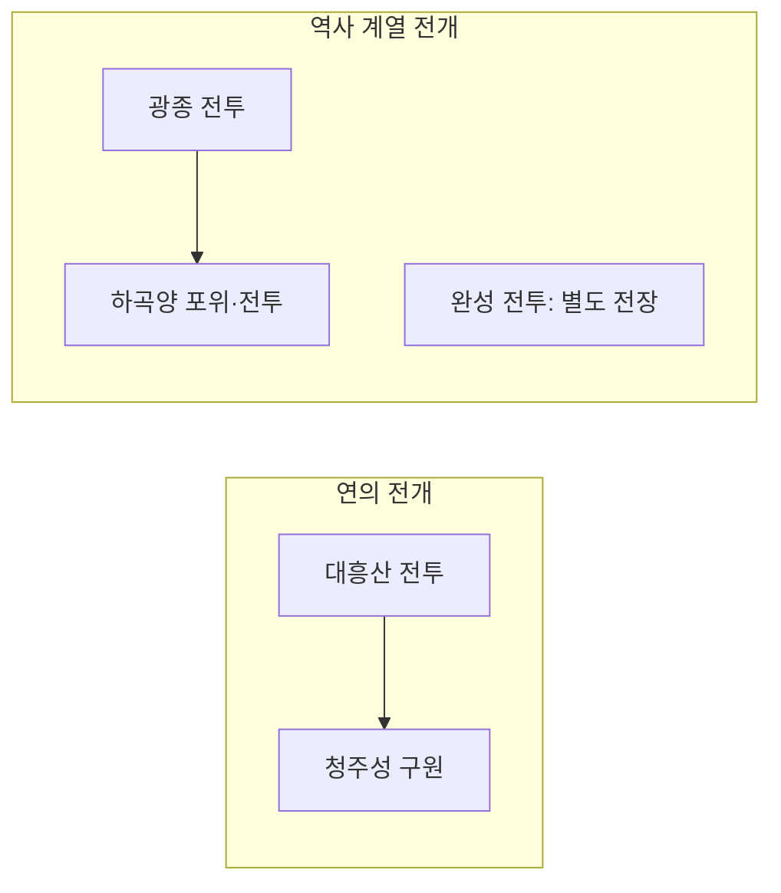
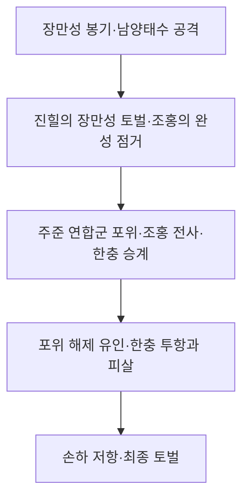

# 5.1 황건적의 난 재수집

> 2026-10-16 현재 활성 범위는 184년·20세 테스트와 5.1 실행 사건 7개, 상위 연표 6개입니다. 장수 1,000명은 유지합니다. 이전 연간 성장·전체 연표 설명은 당시 기록입니다. 현재 구현·저장·편집 방법은 [5.1 실행 문서](CHAPTER_5_1_RUNTIME.md)를 우선 확인하세요.

작성일: 2026-10-16. [사건 인과관계 설계](CAUSAL_EVENT_DESIGN.md)를 적용한 첫 수집 단위다.

## 상태

**5.1의 지정 범위 수집을 완료했다.** Gemini CLI가 연표와 황건적의 난 페이지를 직접 읽었고, 전투 5개·전개 단계 18개를 구조화했다. 사용자 지정에 따라 원페이지 서술·이견을 보존하고 원사서를 새로 대조하지 않았다.

자료는 [수집 JSON](../data/collection/5-1-yellow-turban.json)에 저장했다. 상위 경과 6개·인물 26개·장소 5개·자료 근거 5개·사건 연결 후보 2개를 포함한다. 기존 연표·장수 파일과 실행 카탈로그는 덮어쓰지 않았다. `/admin/collection`에서 플로우차트로 조회할 수 있다. 실행 엔진 연결 전이므로 `playable: false`를 유지하며 Firebase의 활성 카탈로그에도 아직 게시하지 않았다.

## 관리자 플로우차트 조회

`http://localhost:3000/admin/collection` 또는 사건 관리의 **수집 플로우** 메뉴로 연다. 연표·장수 화면의 **5.1 수집 플로우** 링크로도 이동할 수 있다.

- **사건 간 연결**: 전투 5개와 연결 후보 2개를 표시한다. 완성은 별도 전장이므로 다른 사건에 임의 연결하지 않는다. 노드를 선택하면 상세 기록, 두 번 누르면 내부 전개가 열린다.
- **전투 내부 전개**: 전투 목록에서 선택해 각 단계와 결과를 본다. 단계 노드나 전개 바로가기를 누르면 행동·장소·선행 상황·행위자가 표시된다.
- **개입 후보 표시**: 게임 창작 후보를 점선과 별도 색으로 표시한다. 후보 선택 시 역할·판정 요소·달라질 수 있는 결과를 본다. 확정된 선택지나 실행 가능한 분기로 표시하지 않는다.
- 상세에는 인물의 장수 ID·사용자 확정 여부, 출처·사서기록 미확인, 원페이지 이견·재확인 메모가 포함된다. 수집 메타데이터의 사이트 URL은 자료 출처 표시로 대체하지 않는다.
- 확대·축소·전체 보기와 드래그 이동을 지원한다. 모바일은 세로 배치로 읽고 전개·개입 후보 목록에서 바로 이동할 수 있다.

현재는 조회 전용이다. 이 화면에서 수집본을 바꾸거나 게임에 게시하지 않는다. 기존 실행 플로 편집은 `/admin/events`에 그대로 있다.

조회 도구 미노출 문제는 CLI 시작 전 작업 폴더 신뢰 상태를 전달하는 방식으로 해결했다. Codex가 대상 페이지를 대신 조회하지 않았다. 모델은 `gemini-3.8-flash`, CLI는 `0.63.0`이다. 실제 `web_fetch` 본문 조회 6회(초기 2회·같은 페이지 재확인 4회)와 검색 2회를 확인했다. [환경 수정·재사용 방법](GEMINI_WEB_COLLECTION.md)에 원인과 실행기를 기록했다.

## 수집 결과

| 하위 절 | 사건 ID | 분류 | 전개 단계 |
|---|---|---|---:|
| 4.1 대흥산 전투 | `battle-184-daxingshan` | 연의 | 4 |
| 4.2 청주성 전투 | `battle-184-qingzhou-city` | 연의 | 3 |
| 4.3 완성 전투 | `battle-184-wan` | 역사 계열·원사서 미확인 | 5 |
| 4.4 광종 전투 | `battle-184-guangzong` | 역사 계열·원사서 미확인 | 4 |
| 4.5 하곡양 전투 | `battle-184-xiaquyang` | 역사 계열·원사서 미확인 | 2 |

각 사건에 개요·단계별 인물/행동/장소/전제·결과·근거·미확인 사항을 저장했다. 플레이어의 관군·황건군·현지 주민별 개입 후보는 게임 창작으로 따로 표시했다. 통솔·무력 등 판정 요소만 적었으며 임계값·승률·실행 효과는 확정하지 않았다.

사건 간 연결 후보는 연의의 `대흥산 → 청주성`, 광종 이후의 `광종 → 하곡양`이다. 완성을 두 전투 사이에 강제로 끼워 넣지 않는다. 후보는 아직 실행 조건이나 실제 게임 연결선이 아니다.



완성의 내부 전개는 원페이지의 수령 교체와 공성 과정을 다음처럼 분리했다. 각 단계의 개입 후보는 JSON의 `gameplayDraft`에 별도로 있다.



## 사용자 결정과 남겨 둔 미확인 정보

- 조홍은 `rtk14-0620`, 한충은 `rtk14-0173`으로 사용자 확정 연결했다.
- 광종 말미·하곡양의 장보 관련 결말은 원페이지대로 각각 남겼다. 중복 사망을 실행하는 규칙을 만들지 않았다.
- 처음에는 하곡양의 10월/11월을 같은 날짜의 충돌로 의심했으나 재조회 결과 10월은 광종 승리 후 북진·포위 문맥, 11월은 인포박스의 전투 시기였다. 둘 다 보존하며 확정된 모순으로 분류하지 않는다.
- 청주성 병력은 인포박스와 본문의 수치를 각각 남겼다. 매복 위치도 원페이지대로 기록하고 임의로 양쪽 산으로 고치지 않았다.
- 완성의 황건군 손하 표기는 `孫夏`다. 시트의 동명 손하 `rtk14-0543`(170~204)와 동일인임이 확인되지 않아 별도 인물 ID와 `officerId: null`로 보존한다. 손중으로 바꾸지도 않았다.
- 완성 하위절에 손견이 직접 언급되지는 않는다. 기존 연표의 손견 완 토벌 항목과의 대응은 남겼지만 새 참전 장면을 만들어 넣지 않았다.
- 세 역사 전투의 본문·각주에 원사서명·권전명이 명시되지 않아 `원사서 미확인`으로 저장했다. Gemini가 추정했던 후한서·삼국지·자치통감 서명은 확정 출처로 채택하지 않았다.
- 원사서를 직접 대조한 한국어 사서기록은 `record: null`이다. 원페이지 결과 요약은 `secondarySummary`로 분리했다. 연의 두 전투의 원전 회차도 직접 대조하지 않았다.

수집 완료는 지정 페이지 범위를 구조화했다는 뜻이다. 원사서 검증·완성된 분기 엔진·공유 DB 게시 완료라는 뜻은 아니다.

## 고정 수집 범위

- 연표의 `5. 본편 → 5.1. 184년`에서 황건적의 난과 그 하위 경과를 식별한다.
- `황건적의 난` 링크로 들어가 아래 전투 5개만 상세 수집한다. 실제 페이지의 제목·절 번호도 조회 시 확인한다.
- `4.1 대흥산 전투`, `4.2 청주성 전투`, `4.3 완성 전투`, `4.4 광종 전투`, `4.5 하곡양 전투`.
- 평가·기타 창작물 항목과 오두미교·흑산적 등 불필요한 링크를 따라가지 않는다. 다른 전투를 임의 추가하지 않는다.
- 독립적인 탄생·사망 알림은 제외한다. 전투 전개를 결정하는 전사·생존·포로 등은 전투 결과 안에서 기록하며 독립 사망 이벤트를 만들지 않는다.
- 이번 작업에서 5.2를 수집하지 않는다. 5.1 완료 보고 후 사용자에게 다음 항목 진행 여부를 묻는다.

## 수집 데이터 형식

하나의 황건적의 난 사건군 아래 전투 5개의 카드를 작성했다. 기존 실행 형식에 억지로 넣지 않고 설계에 따른 구조화 자료로 검증했다. 새 엔진이 구현되지 않은 선택·결과는 실행 가능하다고 표시하지 않는다.

각 카드의 항목:

1. 사건 ID·기존 연표 대응 ID·상위 사건군 ID.
2. 연월·정확도·문헌상 이견. 모르는 월은 `null`.
3. 지역 ID와 도시·군·주·전장 구분, 확인된 이동 경로.
4. 세력·인물 ID와 현장 역할. 인명만 맞추지 않고 지휘관·발령자·지원자 등을 구별.
5. 배경·목표·개요.
6. 전개 단계: 행위자·행동·장소·전제·앞뒤 관계·문헌 근거.
7. 정사 본문·주석·연의 변형. 나무위키의 사료 소개와 실제 원사서 대조 여부도 구분.
8. 기본 결과와 변화하는 생사·부대·지역 점유·소속·지휘권.
9. 소속·나이·가정·권한·능력에 따른 개입 후보. 게임 창작 표시.
10. 후속 사건이 읽을 상태와 명시적인 선행·대체 연결 후보.
11. 문헌명·권전회차·한국어 사서기록·검증 상태.
12. 불확실한 사항·사용자 질문·수집 범위와 완성도.

사이트 URL은 조사 메타데이터에만 두고 게임용 출처를 대체하지 않는다. 원문·HTML 보관용 `raw` 폴더를 만들지 않는다. Gemini 응답만으로 원사서 검증을 완료했다고 표시하지 않는다.

## 기존 자료 연결점

기존 ID를 보존하고 이번에 재수집한 상위 경과와 연결했다.

| 기존 연표 ID | 현재 항목 |
|---|---|
| `timeline-7a61895372e5296785bd` | 황건적의 난 |
| `timeline-f5dc77023ab7ac336fcc` | 한 조정의 주준·황보숭·노식 파견 |
| `timeline-2f7dea7684980f0eb81c` | 주준의 손견 등용 |
| `timeline-802c23427d48943bd80d` | 동탁의 패전 |
| `timeline-d5ffdbbc9dea6271afef` | 손견의 완 토벌 |
| `timeline-071b84e2b2a7c5142258` | 황건적 궤멸 |

기존 `h184-yellow-turban`, `h184-ref-004`, `h184-ref-007`, `h184-zhangliang` 등의 게임 사건과 의미가 겹친다. 새 수집본을 기존 게임 목록에 자동으로 추가하지 않았다. 추후 실행 정의로 이행할 때 중복 실행을 막아야 한다.

## 완료 검사

게임 문구는 후속 요청에 따라 [이벤트 작성 지침](EVENT_WRITING_GUIDE.md)의 웹소설 문체로 별도 작성했다. 수집본의 사실·출처·이견은 그대로 두고, 실행 사건의 제목·상황·행동·결과에만 적용했다. 이후 수집도 사실 확보 → 분기 설계 → 서사 작성 → 게임·공유본 확인 순서로 완료한다.

```powershell
node --check scripts/run-gemini-web.mjs
node scripts/validate-collected-chapter.mjs
```

실제 Gemini 본문 조회와 위 검사가 통과했다. 구조 검사에서는 범위·분류·단계·인물/지역/근거 참조·사용자 지정·기준 자료 체크섬을 확인했다. 사료의 정확성을 자동 증명하는 검사는 아니다. 아래 기준을 다음 수집 단위에도 적용한다.

- 지정한 5개 전투 각각의 실제 본문 접근 여부와 수집 절을 기록한다.
- 전투별 개요·전개·결과가 있고, 빠진 정보는 미확인으로 명시한다.
- 정사와 연의의 행위자·전개를 섞지 않는다.
- 인물·지역·세력 참조가 유효하고 동명이인·미등록 인물 문제를 확인한다.
- 알려지지 않은 연월·문헌·단계를 지어 넣지 않는다.
- 내부 전개와 사건 간 연결 후보를 구분하고 창작 분기를 사료로 표시하지 않는다.
- 페이지 정보가 모호하거나 수집 범위의 판단이 필요하면 사용자에게 질문한다.
- 5.1의 결과·불확실성·저장 위치를 보고한 뒤 5.2 진행 여부를 묻는다.
